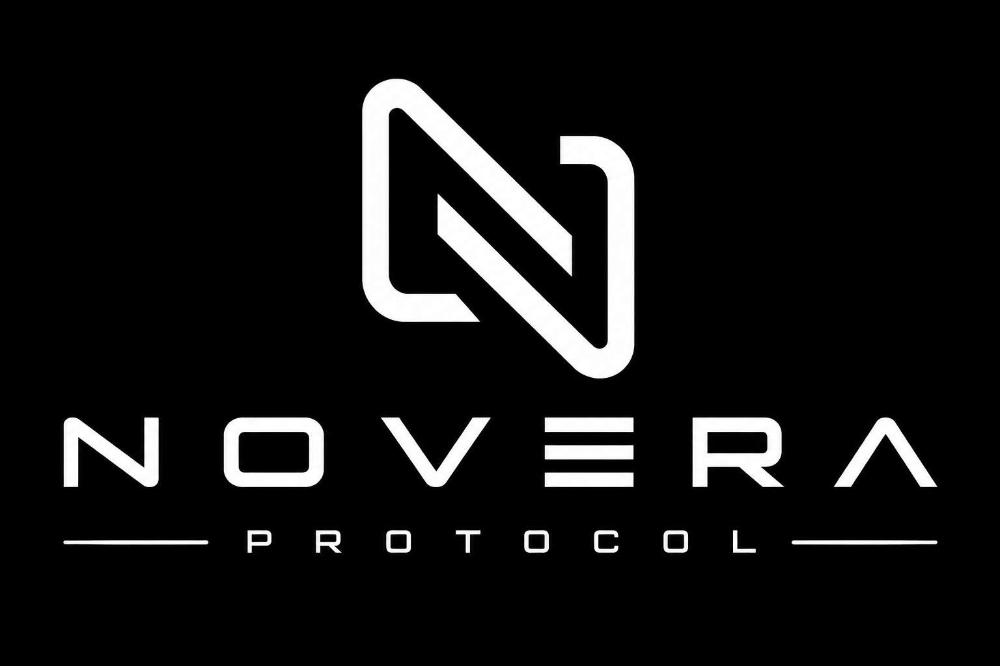

# Novera Protocol

> **Infrastructure for Trust.**
>
> Trust should be engineered, verified, and recorded.

This is Novera Protocol's public investor and ecosystem overview. It is not the production platform repository. Novera is a planned modular platform for real-world-asset (RWA) lifecycle coordination, with an initial focus on asset registration, identity status, registry records, deed-style evidence, and lifecycle visibility.

## Public status

Novera is at a **foundation and prototype-design stage**. The private engineering repository is separate from this public repository. No live blockchain, token, stablecoin, payment rail, custody system, identity-verification provider, legal-document workflow, or production deployment is represented here.

## Product modules

| Module | Intended role | Current public status |
|---|---|---|
| NovaID | Identity and organization verification status | Conceptual; synthetic-data MVP planned |
| NovaRegistry | Asset registration and lifecycle record | Conceptual; synthetic-data MVP planned |
| NovaDeed | Evidence and deed-style record lifecycle | Conceptual; mock artifacts only |
| NovaPay | Future payment and settlement orchestration | Deferred |
| NovaChain | Chain-adapter and settlement interface | Deferred |
| NovaStable | Intended CAD-pegged 1:1 stable-value concept | Not issued; not deployed |
| NovaScan | Future lifecycle visibility | Deferred |
| NovaDAO | Future governance exploration | Deferred |
| Compliance Engine | Policy decisioning and controls | Mock-only MVP foundation |
| Legal API Gateway | Future legal-workflow integration boundary | Deferred |

## Architecture position

- **EVM-first and chain-agnostic:** domain and application layers are designed to avoid coupling to one blockchain.
- **Production chain selection remains open:** Base, Arbitrum, Ethereum mainnet, and other suitable EVM environments require a formal selection exercise.
- **Hedera is optional:** a potential future adapter for enterprise, audit, throughput, or customer-specific requirements—not a mandatory core ledger.
- **Chainlink is optional:** Chainlink Runtime Environment (CRE) may support future verifiable off-chain workflows; CCIP is relevant only where cross-chain functionality is justified.
- **No live integrations are implied:** all current lifecycle examples are synthetic and mock-only.

Read the [investor overview](docs/product/investor-overview.md), [architecture overview](docs/architecture/overview.md), and [roadmap](docs/product/roadmap.md).

## Repository boundaries

### Published here

- Public product and architecture summaries
- High-level roadmap and governance position
- Public security-reporting and contribution guidance
- Investor-facing risk and status disclosures

### Intentionally excluded

- Private source code, database schemas, migrations, CI internals, and infrastructure
- Threat-model details, security implementation notes, credentials, keys, or endpoints
- Customer, identity, asset, payment, compliance, or legal-document data
- Smart contracts, wallets, custody keys, token contracts, or blockchain configuration
- Real KYC/KYB, payment, Chainlink, Hedera, or other live integrations

## Important disclosures

- **NOVA:** no token has been issued. Any reference to a contemplated fixed maximum supply of 1,000,000,000 NOVA tokens is a design position, not an offer, sale, solicitation, or commitment.
- **NovaStable:** no stablecoin has been issued. The intended 1:1 CAD-pegged concept is exploratory and subject to legal, regulatory, banking, reserve, and risk review.
- **No investment offer:** nothing in this repository constitutes investment, legal, tax, accounting, or financial advice, or an offer to sell or solicitation to buy securities, tokens, or other financial instruments.

See [Public disclosures and governance position](docs/governance/public-disclosures.md) and [Publication status](docs/publications/README.md).

## Security and contributions

See [SECURITY.md](SECURITY.md), [CONTRIBUTING.md](CONTRIBUTING.md), and [CODE_OF_CONDUCT.md](CODE_OF_CONDUCT.md).
